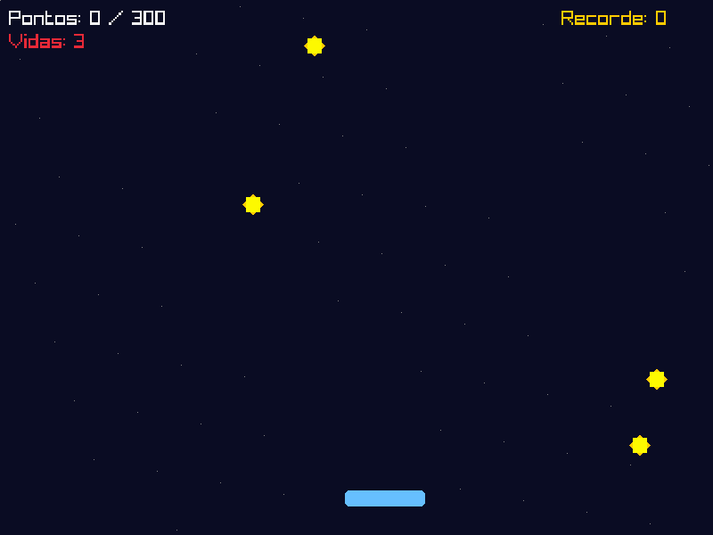

# Cata-Estrelas

Jogo 2D em C com Raylib: mova a plataforma, pegue as estrelas e desvie dos meteoros.



## Integrantes

| Nome completo | R.A. |
|---------------|------|
| Mateus Valenga dos Santos Arruda | 26038923 |
| Guilherme Perpetuo | 26025623 |

## Como jogar

- **Objetivo:** fazer 300 pontos (cada estrela vale 10). O jogo acelera conforme você pontua.
- **Derrota:** cada meteoro tira 1 das 3 vidas; sem vidas, fim de jogo.

| Tecla | Ação |
|-------|------|
| Setas ← → ou A / D | Mover |
| ENTER | Começar / jogar de novo |
| P | Pausar |
| ESC | Sair |

## Instalação

**Baixar pronto (Windows):** pegue o `.zip` na aba [Releases](../../releases), extraia e abra `cata-estrelas.exe`.

**Compilar (Windows, MSYS2):**

1. Instale o [MSYS2](https://www.msys2.org/) e, no terminal *UCRT64*:
   `pacman -S mingw-w64-ucrt-x86_64-gcc mingw-w64-ucrt-x86_64-raylib`
2. Com `C:\msys64\ucrt64\bin` no PATH, rode `build.bat` na pasta do projeto.
3. Abra `cata-estrelas.exe`.

`build.bat teste` roda os testes das regras do jogo.

**Linux:** `gcc src/main.c src/jogo.c -o cata-estrelas -lraylib -lm` (não testado).

## Estrutura

```
src/main.c    janela, loop principal, teclado e desenho (Raylib)
src/jogo.c    regras: movimento, queda dos objetos, colisão, pontos, vitória/derrota
src/jogo.h    tipos e constantes do jogo
tests/teste.c testes das regras, sem janela
```

## Tecnologias

- Linguagem C (C99), compilador GCC (MSYS2 UCRT64)
- [Raylib](https://www.raylib.com/) (licença zlib)

## Assets e créditos

O jogo não usa arquivos de imagem nem de áudio: tudo é desenhado em código com as formas e a fonte padrão da Raylib.

## Transparência IA

- **Imagens e sprites:** nenhum foi gerado por IA (o jogo não usa sprites).
- **Código:** O código base foi feito à mão e revisado pelos agentes IA: Claude. Ele arrumou o sistema de movimentação que estava não funcional; ele também resumiu o READ-ME e fez 2 commits iniciais.
